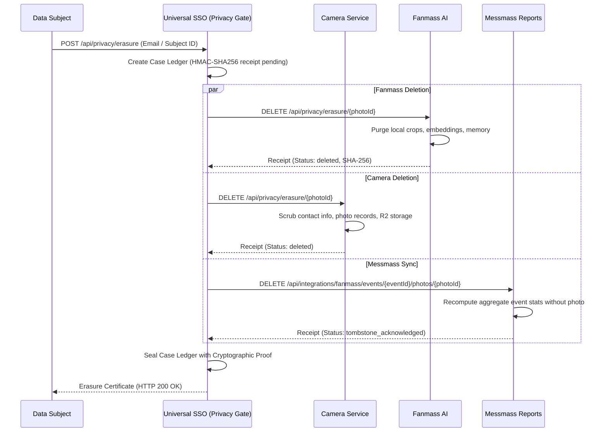

# GDPR Right to Erasure & Zero-Trace Privacy Architecture
Status: Active
Last Updated: 2026-11-20T16:00:00.000Z
Canonical: Yes
Owner: Security / Privacy
Version: 12.7.0

## 1. System Invariant: `INV-004` (GDPR Right to Erasure & Zero-Trace KYC)

- **Zero-Trace Principle**: Biometrics, raw selfies, and user emails are strictly partitioned from anonymous aggregate event statistics.
- **Cryptographic Verification**: Erasure actions across services return an HMAC-SHA256 receipt signed with the service secret.
- Level 0 Contracts:
  - SSO Ledger: [`Architecture/schemas/sso/privacy-erasure-case.json`](file:///Users/Shared/Projects/planetbrain/Architecture/schemas/sso/privacy-erasure-case.json)
  - Camera Records: [`Architecture/schemas/camera/camera-record-erasure.json`](file:///Users/Shared/Projects/planetbrain/Architecture/schemas/camera/camera-record-erasure.json)
  - Messmass Contract: [`Architecture/schemas/messmass/privacy-erasure-contract.json`](file:///Users/Shared/Projects/planetbrain/Architecture/schemas/messmass/privacy-erasure-contract.json)

## 2. Distributed Erasure Flow

## 3. Tombstone & Backup Replay Protection

When a photo is deleted under GDPR Right to Erasure:
1. Durable tombstones are stored with `isDeleted: true` and the cryptographic hash of the deletion request.
2. If historical batch replays or cold backups are restored, the tombstone filter intercepts and discards any restored image records, preventing "resurrection" of deleted data.
