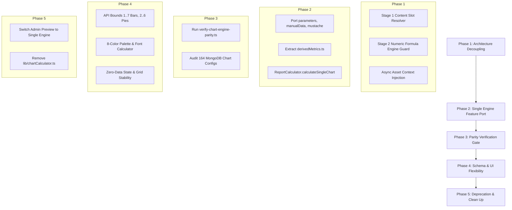

# Master Synthesis & Action Plan: KYC, Algorithms, and Charts Unification

**Document Path:** `/Users/Shared/Projects/messmass/docs/designs/synthesis_kyc_algorithms_charts.md`  
**Date:** 2026-11-04  
**Author:** EGM Goldfish Swarm & Antigravity  
**Status:** Approved by Swarm Consensus  
**Input Reviewers:**  
1. `egm-implementation-readiness` (B-01 to B-04, R-01 to R-03)  
2. `egm-design` (Blocker 1 to 3, Risk 1 to 4)  
3. `egm-zoom-out` (B-1, B-2, R-1, R-2)  
4. `egm-codebase-details` (Blocker 1, Blocker 2, Major 3, Blocker 4, Major 5)  

---

## Executive Summary & Swarm Consensus

Across all four Goldfish reviewers, there is unambiguous technical consensus on the root cause and architectural remedies for Messmass's chart and formula pipeline:

1. **Unanimous Consensus on the "Category Error":**
   All reviewers (`zoom-out`, `design`, `details`, `implementation-readiness`) agree that coercing string literals, editorial copy, media URLs, and content slots into an arithmetic AST parser (`lib/formulaEngine.ts`) is a critical category error. The engine must be partitioned into a **Two-Stage Pipeline**:
   - **Stage 1:** Text & Content Slot Resolver (fast-path string dictionary / asset resolver).
   - **Stage 2:** Pure Numeric Formula Engine (strict arithmetic AST, evaluating only validated numbers).

2. **Reconciliation on `lib/chartCalculator.ts` Deletion vs. Retention:**
   - *Conflict:* `zoom-out` recommended immediate deletion of `lib/chartCalculator.ts` (955 lines of dead code). Conversely, `design` and `codebase-details` warned that dropping it immediately would destroy the derived analytics pipeline (`prepareStatsForAnalytics`, `ensureDerivedMetrics`) and drop features absent from `report-calculator.ts` (`parameters`, `manualData`, mustache replacement `{{fieldName}}`).
   - *Resolution:* Adopt a phased deprecation gate. First, extract `prepareStatsForAnalytics` into a dedicated domain module (`lib/analytics/derivedMetrics.ts`), port missing features (`parameters`, `manualData`, mustache interpolation) and add the single-chart preview adapter `ReportCalculator.calculateSingleChart`. Run `scripts/verify-chart-engine-parity.ts` against all 164 live MongoDB configurations. Delete `chartCalculator.ts` only after 100% parity verification passes.

3. **Reconciliation on KYC Catalog & Content Slots:**
   - *Conflict:* `implementation-readiness` proposed database catalog migration for slots; `zoom-out` warned against database catalog pollution.
   - *Resolution:* Do NOT pollute MongoDB collections with synthetic slots. Define static code-level slot schemas in `lib/contentSlots.ts` (`reportImage1..N`, `reportText1..N`). Expose them cleanly in the admin UI as a dedicated "Layout Slots" group while normalizing variable lookups (`[female]` vs `[stats.female]`) in code.

4. **DOM Layout Stability vs. Historical Integrity:**
   - Silent dropping of empty/0-sum charts in `ReportContent.tsx` collapses desktop CSS grid layouts. Replace silent deletion with an explicit, neutral zero-data placeholder, preserving layout geometry while distinguishing between genuine 0-values and evaluation errors.

---

## Prioritized Findings & Deduplicated Matrix

| ID | Severity | Problem Domain | Source Reviewers | Core Issue & Resolution |
|---|---|---|---|---|
| **B-01** | 🔴 Blocker | Architecture / Grammar | Rev 1 (B-01), Rev 2 (B-1), Rev 3 (B-1), Rev 4 (B-1) | **AST Tokenizer String Crash (`formulaEngine.ts:770`).** Decouple into Stage 1 Content Slot Resolver & Stage 2 Pure Numeric Math Engine. Never feed arbitrary string tokens to AST math parser. |
| **B-02** | 🔴 Blocker | Parity & Deprecation | Rev 1 (B-02), Rev 2 (B-3), Rev 3 (B-2), Rev 4 (B-2) | **Feature Gaps & Derived Analytics Loss in `report-calculator.ts`.** Port `parameters`, `manualData`, mustache label replacement (`chartCalculator.ts:179-199`), extract `ensureDerivedMetrics`/`prepareStatsForAnalytics`, and implement `ReportCalculator.calculateSingleChart`. |
| **B-03** | 🔴 Blocker | SSR / Serverless Runtime | Rev 2 (B-2) | **Cold-Start Synchronous Fetch Failure (`fetchContentAssetsSync`).** Content assets cannot be fetched synchronously in SSR. Inject pre-fetched asset dictionaries into evaluation context. |
| **B-04** | 🔴 Blocker | Layout & UX | Rev 1 (B-03), Rev 2 (R-3, R-4), Rev 3 (R-2), Rev 4 (B-4) | **Silent Chart Vanishing & Grid Collapse (`ReportContent.tsx:46-54`, `ReportChart.tsx:137-175`).** Render zero-data state placeholder rather than dropping DOM node. Distinguish true 0 from calculation error. |
| **M-01** | 🟡 Major | Schema & SVG Limits | Rev 1 (B-04), Rev 2 (R-2), Rev 4 (M-5) | **Rigid Element Validation & Palette Modulo Bug (`chart-config/route.ts`, `ReportChart.tsx:805-820`).** Relax counts to Bar (1..7) and Pie (2..6). Fix Pie `% 2` color cycling; expand palette and update `barChartFontSizeCalculator.ts`. |
| **M-02** | 🟡 Major | Variable Resolution | Rev 1 (R-03), Rev 2 (R-1), Rev 4 (M-3) | **Syntax Disconnect (`[var]` vs `[stats.var]`, `variables_metadata`).** Normalize identifier path resolution in `substituteVariables` (support `stats.` prefix fallback) and preserve legacy regex bypasses. |
| **M-03** | 🟡 Major | Catalog Architecture | Rev 1 (R-01), Rev 3 (R-1) | **Catalog Pollution vs Convention.** Implement static code registry in `lib/contentSlots.ts` for `reportImage1..N` without seeding synthetic records into MongoDB. |
| **N-01** | 🟢 Nit / Refinement | Verification Tooling | Rev 1 (R-02) | **Dual-Engine Automated Gate.** Build `scripts/verify-chart-engine-parity.ts` to test 164 live MongoDB chart configs across both engines before switching traffic. |

---

## Detailed Technical Reconciliations & Decisions

### 1. The Two-Stage Evaluation Pipeline (Decoupling Content from Math)
- **Problem:** `lib/formulaEngine.ts` treats every formula as an arithmetic expression. When encountering text slots (`[TEXT:welcome]`, `stats.reportImage1`, markdown, or quoted strings), `tokenizeExpression` throws an unhandled error at line 770 (`Unsupported token: "`).
- **Architectural Solution:**
  ```
  Input Formula / Slot Expression
                │
    Is Content Slot / String / Markdown?
         ┌──────┴──────┐
        YES            NO
         │             │
  [Stage 1: Slot]   [Stage 2: Formula]
  Direct String     Arithmetic AST Parser
  Interpolation     (Numbers, Variables, +, -, *, /,
  & Asset Registry   SUM, AVG, ABS, MIN, MAX)
  ```
  - Stage 1 handles `[TEXT:*]`, `[MEDIA:*]`, `reportImage*`, `reportText*`, and static string templates.
  - Stage 2 receives only validated numeric variables and operators. If an unrecognized string token reaches Stage 2, it produces a typed `EvaluationError` instead of throwing an unhandled exception.

### 2. Preserving Derived Analytics & Porting Missing Calculator Features
- **Problem:** `lib/chartCalculator.ts` contains 955 lines, including:
  1. `prepareStatsForAnalytics` / `ensureDerivedMetrics`: derived metric calculations critical to partner and aggregate reports.
  2. Dynamic mustache interpolation (`{{fieldName}}` lines 179-199).
  3. `parameters` and `manualData` override handlers.
- **Architectural Solution:**
  - Create `lib/analytics/derivedMetrics.ts` and migrate `ensureDerivedMetrics` / `prepareStatsForAnalytics` out of `chartCalculator.ts`.
  - Add `calculateSingleChart(config, projectStats, options)` to `ReportCalculator` (`lib/report-calculator.ts`).
  - Wire `ChartAlgorithmManager.tsx` preview to `ReportCalculator.calculateSingleChart`.
  - Maintain `chartCalculator.ts` in legacy read-only mode until parity verification script completes.

### 3. Serverless Cold-Start Content Asset Resolution
- **Problem:** Relying on `fetchContentAssetsSync` or uninitialized in-memory cache during SSR cold starts produces race conditions and blank content.
- **Architectural Solution:**
  - Pre-fetch content assets asynchronously in Next.js data fetching layers (`getServerSideProps` or route handlers).
  - Inject the resolved `Record<string, ContentAsset>` map directly into `ReportCalculatorContext`.
  - All downstream resolution is synchronous in-memory lookup against the injected context.

### 4. Grid Stability & Zero-Data State Rendering
- **Problem:** `ReportContent.tsx:46-54` executes `hasValidChartData()`. If a chart's values evaluate to 0, it returns `false`, causing the chart card to be omitted from the DOM. This breaks the CSS Grid layout (line 341), creating misaligned card gutters and empty visual slots.
- **Architectural Solution:**
  - Separate data validity into two explicit states:
    1. **Empty / Zero Data:** The chart evaluated successfully, but values are zero or empty. Render a stylized zero-state placeholder (neutral horizontal baseline or subtle icon with "No data recorded") that occupies the exact grid dimensions.
    2. **Evaluation Error:** Calculation failed due to missing required stats. Render an operator-friendly badge or subtle fallback card; log error details for admin diagnostics.
  - Do NOT mutate DOM structure of archived/historical reports; guard new rendering behind report layout versioning.

### 5. Dynamic Element Constraints & Palette Extensions
- **Problem:**
  - `app/api/chart-config/route.ts:138-170` rejects bar charts with $\neq 5$ bars and pie charts with $\neq 2$ slices.
  - `ReportChart.tsx:805-820` computes pie slice colors with `colors[index % 2]`, alternating between two colors even if more slices exist.
  - `barChartFontSizeCalculator.ts:169-175` calculates bar widths assuming exactly 5 elements.
- **Architectural Solution:**
  - Relax validation bounds: Bar charts support **1 to 7 elements**; Pie charts support **2 to 6 slices**.
  - Define a cohesive, accessible categorical color palette of 8 colors in `ReportChart.tsx` (e.g., `#2563EB`, `#10B981`, `#F59E0B`, `#EF4444`, `#8B5CF6`, `#06B6D4`, `#EC4899`, `#64748B`). Replace `% 2` with `% palette.length`.
  - Update `barChartFontSizeCalculator.ts` to compute dynamic font sizes and spacing based on `elementCount`.
  - Update `ChartAlgorithmManager.tsx` UI editor to permit adding/removing elements within the 1..7 / 2..6 boundaries.

### 6. KYC Catalog & Variable Syntax Unification
- **Problem:** Database contains mixed syntax (`[female]`, `[stats.female]`, `stats.reportImage1`).
- **Architectural Solution:**
  - Define static code definitions in `lib/contentSlots.ts` for recognized layout slots (`reportImage1..N`, `reportText1..N`).
  - In `substituteVariables`:
    1. Normalize variable tokens by stripping optional `stats.` prefix when querying the variable dictionary.
    2. Check `project.stats[varName]`, falling back to `project[varName]`.
    3. Retain existing regex bypass lists for built-in formula operations (`ABS`, `SUM`, `AVG`, `MIN`, `MAX`).

---

## Actionable 5-Phase Implementation Plan



### Phase 1: Two-Stage Formula & Content Resolver
1. Create `lib/resolvers/contentSlotResolver.ts` to handle string literals, markdown, and content tokens (`[TEXT:*]`, `[MEDIA:*]`, `reportImage*`, `reportText*`).
2. Add token type guard in `lib/formulaEngine.ts`: non-numeric tokens bypass AST parsing and route through the Content Slot Resolver.
3. Update server-side data loaders to pre-fetch content assets and pass an immutable asset map into calculator context.

### Phase 2: Feature Porting & Unified Adapter
1. Extract `prepareStatsForAnalytics` and `ensureDerivedMetrics` from `lib/chartCalculator.ts` into `lib/analytics/derivedMetrics.ts`.
2. Port `parameters`, `manualData`, and mustache interpolation (`{{fieldName}}`) into `lib/report-calculator.ts`.
3. Implement `ReportCalculator.calculateSingleChart` matching the preview signature needed by `ChartAlgorithmManager.tsx`.

### Phase 3: Parity Verification Gate (164 Configs)
1. Write `scripts/verify-chart-engine-parity.ts`.
2. Run automated regression comparing calculation results of `chartCalculator.ts` vs `report-calculator.ts` across all 164 active MongoDB chart configs.
3. Require 100% parity before proceeding to Phase 4.

### Phase 4: Schema Relaxation, Palette & Zero-State Grid
1. Relax validation in `app/api/chart-config/route.ts` to Bar (1..7) and Pie (2..6).
2. Update `ChartAlgorithmManager.tsx` UI to dynamically support add/remove element rows up to limits.
3. Replace `index % 2` color cycling in `ReportChart.tsx` with an 8-color categorical palette; update `barChartFontSizeCalculator.ts` scaling.
4. Update `ReportContent.tsx` to render explicit zero-data placeholders instead of deleting chart containers from the DOM.

### Phase 5: Deprecation & Final Deletion
1. Switch `ChartAlgorithmManager.tsx` to use `ReportCalculator.calculateSingleChart`.
2. Verify all CI checks (`type-check`, `lint`, `test`, `fleet-audit-inventory.py`).
3. Delete `lib/chartCalculator.ts`.

---

## Verification Gates & Invariants

1. **Safety Invariant:** Zero regressions across all 164 active MongoDB chart configs verified by `scripts/verify-chart-engine-parity.ts`.
2. **Grammar Invariant:** `formulaEngine.ts` never throws unhandled tokenizer exceptions on string/media tokens.
3. **Layout Invariant:** Desktop CSS Grid column count and dimensions in `ReportContent.tsx` remain invariant regardless of chart zero-data states.
4. **CI Invariant:** Clean runs of:
   - `npm run type-check`
   - `npm run lint`
   - `npm run test`
   - `python3 scripts/fleet-audit-inventory.py --check`
